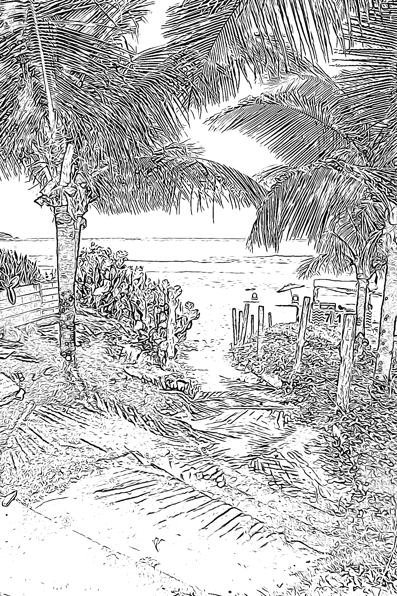

# Flow-based Difference of Gaussians (FDoG)

A CPU-based, multithreaded implementation of **Flow-based Difference of Gaussians (FDoG)** in C using OpenMP.

FDoG is an edge-detection technique used in non-photorealistic rendering (NPR). Unlike conventional edge detectors, it uses the local structure and direction of image edges to produce coherent, stylized black-and-white line drawings.

The implementation uses a structure tensor to estimate edge directions, applies Difference of Gaussians perpendicular to those directions, and smooths the resulting responses along the edges.

## Results

The following images demonstrate the input and the resulting FDoG stylization.

### Original Image


### FDoG Output



### Side-by-side Comparison

| Original | FDoG |
|:---:|:---:|
|  |  |

## Features

- **Flow-based edge detection:** Uses Edge Tangent Flow (ETF) to maintain coherent edge directions.
- **Difference of Gaussians:** Detects edges by filtering perpendicular to the local edge direction.
- **Flow-based smoothing:** Smooths edge responses along the estimated edge directions.
- **OpenMP parallelization:** Accelerates computationally intensive image-processing stages using CPU multithreading.
- **No external image-processing libraries:** Uses standard C libraries, math functions, and OpenMP.
- **Configurable thread count:** Allows the user to specify the number of CPU threads.

## Algorithm Pipeline

The implementation follows these steps:

1. **Grayscale Conversion:** Converts the RGB input image into grayscale.
2. **Gradient Calculation:** Computes horizontal and vertical image gradients using Sobel operators.
3. **Structure Tensor:** Constructs the structure tensor from the image gradients and smooths its components using Gaussian blur.
4. **Edge Tangent Flow (ETF):** Estimates the local edge tangent direction from the dominant eigenvector of the smoothed structure tensor.
5. **DoG Filtering:** Applies a Difference of Gaussians filter perpendicular to the local edge direction.
6. **Flow-based Smoothing:** Traces the edge tangent flow in both directions and smooths the filter responses along the edges.
7. **Normalization and Thresholding:** Normalizes the response using its RMS value and applies a soft threshold to produce the final black-and-white image.

## Requirements

- GCC compiler
- OpenMP support
- Standard C math library
- Linux or another GCC-compatible environment

No additional image-processing libraries are required.

## Compilation

Compile the project using:

```bash
gcc -O3 -march=native -fopenmp fdog.c -lm -o fdog
```

Compiler flags:

| Flag | Description |
|---|---|
| `-O3` | Enables aggressive compiler optimizations. |
| `-march=native` | Optimizes instructions for the current CPU architecture. |
| `-fopenmp` | Enables OpenMP parallelization. |
| `-lm` | Links the C math library. |

## Usage

The program accepts an input image, an output image, and an optional thread count.

```bash
./fdog input.ppm output.ppm [threads]
```

### Arguments

| Argument | Description |
|---|---|
| `input.ppm` | Input image in binary PPM (P6) format. |
| `output.ppm` | Output image in binary PPM (P6) format. |
| `threads` | Optional number of OpenMP threads. Defaults to 4. |

### Example

Run using the default thread count:

```bash
./fdog input.ppm output.ppm
```

Run using 8 threads:

```bash
./fdog input.ppm output.ppm 8
```

### Converting Images

The program accepts binary PPM (P6) images with a maximum pixel value of 255.

You can use ImageMagick to convert other image formats into PPM:

```bash
magick input.jpg -compress none input.ppm
```

After processing, convert the output PPM into PNG:

```bash
magick output.ppm output.png
```

## OpenMP Parallelization

The implementation uses OpenMP to distribute independent pixel-processing operations across multiple CPU threads.

Parallelized operations include:

- RGB-to-grayscale conversion.
- Sobel gradient calculation.
- Structure tensor construction.
- Gaussian blur (horizontal and vertical passes).
- Edge tangent flow calculation.
- DoG filtering across edges.
- Flow-based smoothing along edges.
- RMS normalization and soft thresholding.

Each output pixel can generally be calculated independently during these stages, making them suitable for data parallelism.

The implementation uses `schedule(static)` to distribute iterations across threads with relatively low scheduling overhead.

The flow-based smoothing stage is particularly interesting because each pixel independently traces its local edge direction in both directions while sampling neighboring responses.

## Configuration

The main algorithm parameters are defined near the beginning of `fdog.c`:

| Parameter | Default | Description |
|---|---:|---|
| `SIGMA_C` | 2.0 | Gaussian smoothing of the structure tensor. |
| `SIGMA_E` | 1.0 | Narrow Gaussian width in the DoG filter. |
| `SIGMA_S` | 1.6 | Wider Gaussian width in the DoG filter. |
| `RHO` | 0.99 | Relative weight of the wider Gaussian. |
| `SIGMA_M` | 3.0 | Smoothing distance along the edge flow. |
| `PHI` | 4.0 | Steepness of the final soft threshold. |
| `EPSILON
